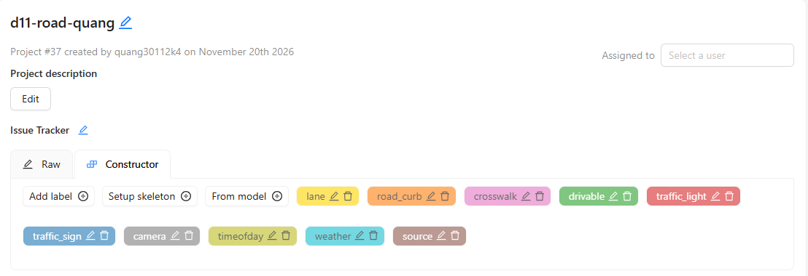
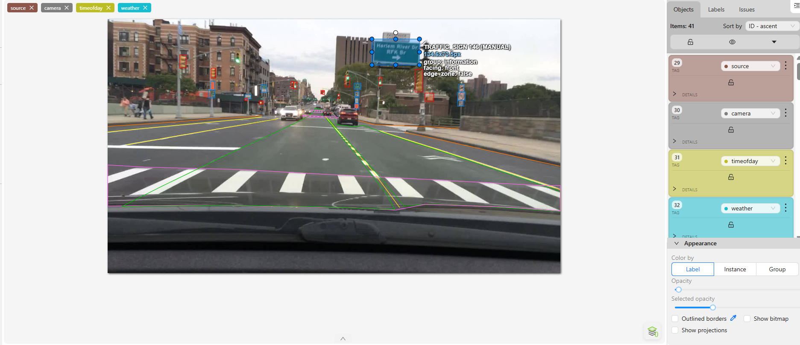
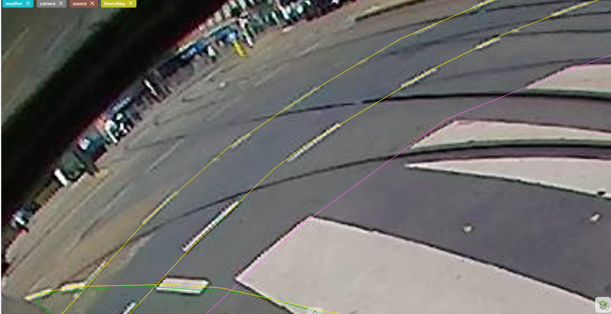
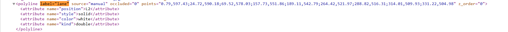

# Báo cáo cá nhân — Ngày 11

Họ tên: Nguyễn Văn Quang  
Mã học viên: 2A202603200  
Phiên bản CVAT (Help → About): **2.74.1** (CVAT local)  
Guideline: Road v1.0    Lần nộp (`revision` trong manifest): 3  
Thời điểm manifest: 21/11/2026 20:29:23 (UTC+7)    Số lần nộp lại sau Rework: 2

## 1. Kiểm project

| Mục | Đúng như guideline Road v1.0? | Ghi chú |
| --- | --- | --- |
| 6 label, đúng kiểu | Có theo export CVAT 1.1 | ZIP mở được bằng `road_check`; kiểm lại tab Labels và chèn ảnh chụp ở mục 6. |
| Thuộc tính và giá trị | Có theo cấu trúc export | Các shape/tag được đọc; cần đối chiếu tab Labels của project trong ảnh chụp. |
| 4 tag ảnh | Có | Manifest ghi đủ tag cho 12/12 ảnh front và 8/8 ảnh fisheye. |

Cách kết thúc polyline trên bản CVAT này: Bấm N để vào chế độ vẽ polyline, click từng điểm từ gần ra xa, bấm N lần nữa để kết thúc; sau đó mở DETAILS sửa thuộc tính.  
Cách đặt tag ảnh trên bản CVAT này: dùng Tag annotation ở thanh công cụ bên trái, chọn label (camera, timeofday, weather, source) rồi đặt cho ảnh; sau đó mở DETAILS của từng tag để sửa lại giá trị CVAT tự điền.

## 2. Số lượng đã gán

| Task | Ảnh | lane | road_curb | crosswalk | drivable | traffic_light | traffic_sign |
| --- | ---: | ---: | ---: | ---: | ---: | ---: | ---: |
| front | 12 | 37 | 18 | 9 | 28 | 46 | 48 |
| front-extra (đã làm 4 / 4) | 4 | 12 | 7 | 8 | 9 | 14 | 24 |
| fisheye | 8 | 8 | 12 | 10 | 11 | 6 | 15 |
| fisheye-extra (đã làm 4 / 4) | 4 | 0 | 4 | 7 | 4 | 1 | 1 |

Ảnh thêm đã được gộp vào `quang-front.zip` (A01–A16, 16 ảnh) và `quang-fisheye.zip` (B01–B12, 12 ảnh) ở revision 3.

## 3. Bảng ca khó

| Ảnh | Nhãn | Phân vân giữa | Đã chọn | Lý do |
| --- | --- | --- | --- | --- |
| A05 (L1, R1), A06 (R1), A07 (L1), A09 (R1), A14 (R1) | lane | Có nên thêm L1/R1 khi không thấy vạch sơn | Không vẽ vạch không có trong ảnh | Tôi khẳng định các ảnh này không thấy vạch ở phía đó. Đề nghị coach xác nhận miễn QC1-02 cho 5 ảnh trên (lint báo 6 cảnh báo nặng, đều là QC1-02; không còn cảnh báo nặng loại khác). |
| A01, A04, A09, A11, A14 | lane | Một hay hai nét cho vạch đôi | Vẽ theo sát hai vệt sơn; đặt `kind=double` | Quy tắc lớp đã xác nhận: hai vệt của vạch đôi được thể hiện riêng. Cảnh báo lặp `position` của checker không tự động là lỗi trong trường hợp này. |
| B02–B05 | traffic_light / traffic_sign | `edge_zone` theo khoảng cách tới tâm ảnh | Giữ thuộc tính đã tự kiểm | Đã rà trực quan và giữ nhãn hiện tại; lint chỉ là gợi ý theo phép đo bán kính gần đúng. |

## 4. Phiếu QC 1 nhận được

Bạn kiểm lô của tôi: Phạm Tiến Phát. Quyết định nhận được: **Rework** (10 lỗi chính / 85 nhãn = 11,8%; 1 lỗi nhẹ). Phiếu kiểm ban đầu không có manifest; bản đã nộp lại là revision 3.

| Mã lỗi | Số lỗi | Đồng ý? | Đã sửa? |
| --- | ---: | --- | --- |
| QC1-01 | 1 | Không đồng ý: ảnh A07 có giọt nước trên kính chắn gió, không phải mưa đang rơi | Giữ `overcast` |
| QC1-05 | 3 | Không đồng ý với lỗi tách vạch đôi; hai vệt được vẽ riêng theo quy tắc lớp | Giữ theo quy tắc vạch đôi |
| QC1-07 | 3 | Đồng ý với drivable A01 (chỉ còn 1 polygon `direct`, hai làn còn lại là `alternative`). A04: không đồng ý, cạnh trên của polygon `alternative` bám theo vạch trắng R2, nên dải xe đạp bên ngoài vạch không bị phủ. B05: không đồng ý, ảnh đã có polygon `crosswalk` lớn phủ vạch ngựa vằn cạnh xe (x 199–896, y 107–670) | A01: đã sửa ở revision 3. A04, B05: giữ nguyên |
| QC1-11 | 4 | Đồng ý với B06 (lane chỉ 3 điểm); 3 lỗi `edge_zone` của B05 đã tự rà và giữ nguyên theo đánh giá ảnh | B06: đã sửa, lane hiện có 10–14 điểm theo cung; `edge_zone` giữ nguyên |

Ghi chú quy tắc vạch đôi: khi vạch có hai vệt sơn, gán từng vệt sát đường sơn và đặt `kind=double`. Không dùng cảnh báo nhiều polyline cùng `position` để kết luận lỗi nếu các polyline đó biểu diễn hai vệt của cùng vạch đôi.

## 5. Kiểm file export

| File | Mở lại được? | Số shape ảnh 1 (job / file) | Số shape ảnh 2 (job / file) | Tag camera có trong XML? |
| --- | --- | --- | --- | --- |
| `quang-front.zip` (A01, A02) | Có | 9 / 9 | 7 / 7 | Có (A01, A02 = front); manifest 16/16 ảnh đủ tag |
| `quang-fisheye.zip` (B01, B02) | Có | 6 / 6 | 7 / 7 | Có (B01, B02 = fisheye_front); manifest 12/12 ảnh đủ tag |

Hai ZIP không kèm ảnh. Hash và kích thước đang khớp với `quang-manifest.json` revision 3.

## 6. Ảnh chụp màn hình

1. **Tab Labels của project** (6 label hình và 4 label Tag):

2. **Ảnh front đã gán đủ lane, drivable, đèn/biển** (4 tag source, camera, timeofday, weather ở góc trên):

3. **Ảnh fisheye đã gán, phóng to polyline cong:**

4. **Đoạn XML có `<polyline label="lane">`:**

## 7. Tự đánh giá

Điểm cần nhớ khi kiểm lane là xác định `position` theo làn xe đang đi và giữ đúng cấu trúc của vạch đôi. Với vạch đôi có hai vệt sơn, nếu gộp thành một nét giữa hai vệt thì mô hình mất hình học của từng vệt và khoảng cách giữa chúng.

Nhãn của tôi đi vào model qua hình học polyline/polygon, thuộc tính shape và tag ảnh. Khi làm Ngày 20, tôi sẽ đối chiếu ảnh và quy tắc lớp trước khi kết luận từ cảnh báo lint.

## 8. (Tùy chọn, buffer) Từ polyline đến đích row-anchor

Chưa ghi hoạt động row-anchor.

## 9. Thay đổi ở revision 3

- Đảo chiều lane vẽ ngược (từ xa về gần) ở A13, A14, A16; thêm điểm theo cung cho lane B06.
- Gộp ảnh thêm vào hai ZIP chính (A13–A16, B09–B12).
- QC1-02 còn lại ở A05, A06, A07, A09, A14 là ảnh không thấy vạch, chờ coach xác nhận miễn. Ở lô của Phát, 4 ảnh A05, A06, A09, A12 cũng chờ coach xác nhận QC1-02 (ghi trong phiếu QC 1).
- B07 (road_curb 2 điểm) và các gợi ý `edge_zone` ở B02–B05, B10 đã rà, giữ nguyên.
